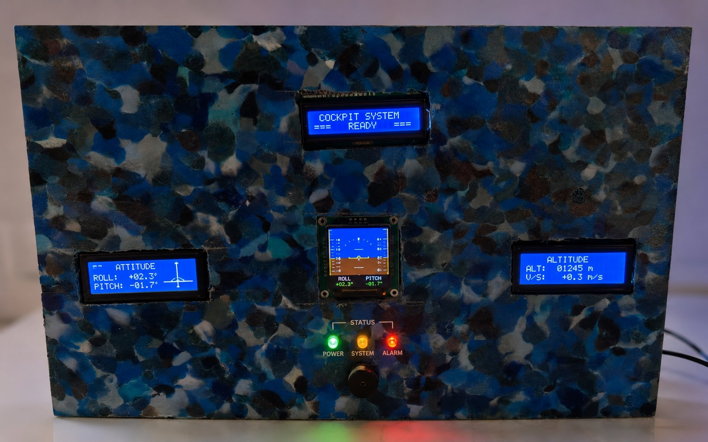

# Tableau de bord aéronautique intelligent

Maquette de tableau de bord embarqué sur **Arduino Mega 2560** simulant un système **GPWS** (Ground Proximity Warning System) et 6 instruments de bord. Projet d'Informatique industrielle, DIC1 Génie Aérospatial, École Polytechnique de Thiès (EPT), présenté le 11 juin 2025 sous la direction de Dr. Thiaw.

**Mon rôle :** programmation du code, montage électronique et assemblage de la maquette.

## Fonctionnement
Un capteur ultrason **HC-SR04** mesure la distance au sol. Le système déduit un niveau d'alerte GPWS et le signale par LEDs, buzzer et écran. Les données de vol (altitude, vitesse, assiette, cap, vitesse verticale, taux de virage) sont **simulées** par des oscillateurs ; il n'y a pas de capteur de mouvement réel.

| Niveau | Distance | LED | Buzzer | Affichage |
|---|---|---|---|---|
| OK | > 100 cm | verte | éteint | `TERRAIN OK` |
| CAUTION | 30 à 100 cm | jaune | 1 kHz, 500 ms | `CAUTION TERRAIN` |
| DANGER | ≤ 30 cm | rouge | 1,5 kHz, 120 ms | `!PULL UP PULL UP` |

*(Seuils à l'échelle de la démonstration.)*

Mesure, alertes et affichages sont rafraîchis toutes les **100 ms**. Le TFT 1,8″ fait défiler **6 instruments toutes les 5 s** : horizon artificiel, anémomètre, directionnel, altimètre, variomètre, indicateur de virage.

## Matériel
- Arduino Mega 2560
- Capteur ultrason HC-SR04
- Écran TFT 1,8″ ST7735 (160×128, SPI)
- 3 écrans LCD 16×2 (GPWS, altimètre, vitesse)
- 3 LEDs 5 mm (verte, jaune, rouge) et un buzzer 5 V
- Alimentation 5 V DC, 2 A (consommation estimée ≈ 800 mA)
- Boîtier 300 × 180 × 70 mm en **plastique recyclé** ([Plastic Odyssey](https://plasticodyssey.org/en/)), avec le soutien du FabLab EPT

## Câblage (broches du code)
| Élément | Broches |
|---|---|
| HC-SR04 | Trig 22, Echo 23 |
| LEDs | verte 24, jaune 26, rouge 28 |
| Buzzer | 30 |
| TFT ST7735 | CS 53, DC 48, RST 49 + SPI matériel (MOSI 51, SCK 52) |
| LCD GPWS (I²C, adresse 0x27) | SDA 20, SCL 21 |
| LCD altimètre (parallèle) | RS 7, EN 6, D4–D7 5, 4, 3, 2 ; contraste PWM 8 |
| LCD vitesse (parallèle) | RS 34, EN 35, D4–D7 36, 37, 38, 39 ; contraste PWM 9 |

## Utilisation
1. Installer l'IDE Arduino et les bibliothèques : `LiquidCrystal_I2C`, `Adafruit GFX Library`, `Adafruit ST7735 and ST7789 Library` (`LiquidCrystal`, `Wire` et `SPI` sont fournies avec l'IDE).
2. Ouvrir `cockpit_simulator/cockpit_simulator.ino`, choisir la carte **Arduino Mega 2560**, puis téléverser.
3. Si le TFT reste vide, changer `TFT_TAB` (par exemple `INITR_BLACKTAB`) ; si les LCD sont peu lisibles, ajuster la valeur PWM de contraste dans `setup()`.

## Contenu du dépôt
- `cockpit_simulator/` : code Arduino
- `docs/` : maquette cotée, prototype, plaque avant assemblage, vidéo de démonstration
- `cad/` : modèle SolidWorks initial (le design de la maquette a ensuite été refait)

## Limites et perspectives
Données de vol simulées, alimentation filaire, non conforme au système réel. Perspectives : capteur de mouvement MPU-6050, WiFi/Bluetooth, connexion à un simulateur de vol.

## Auteur
Papa Moussa DIENE : [LinkedIn](https://www.linkedin.com/in/papa-moussa-diene/) · [GitHub](https://github.com/Skymooz)
